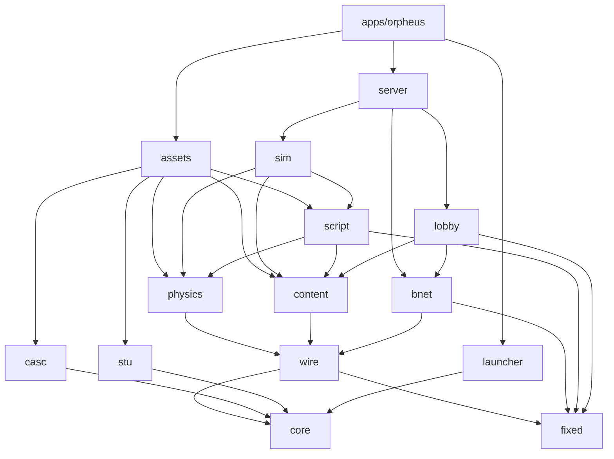
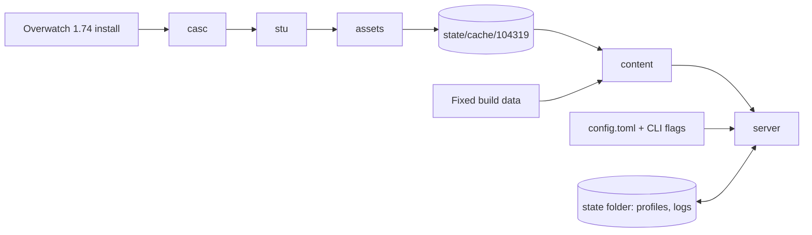
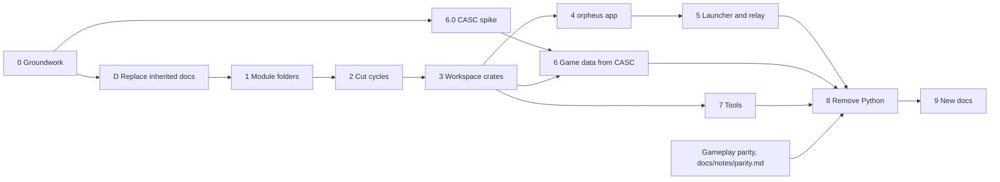
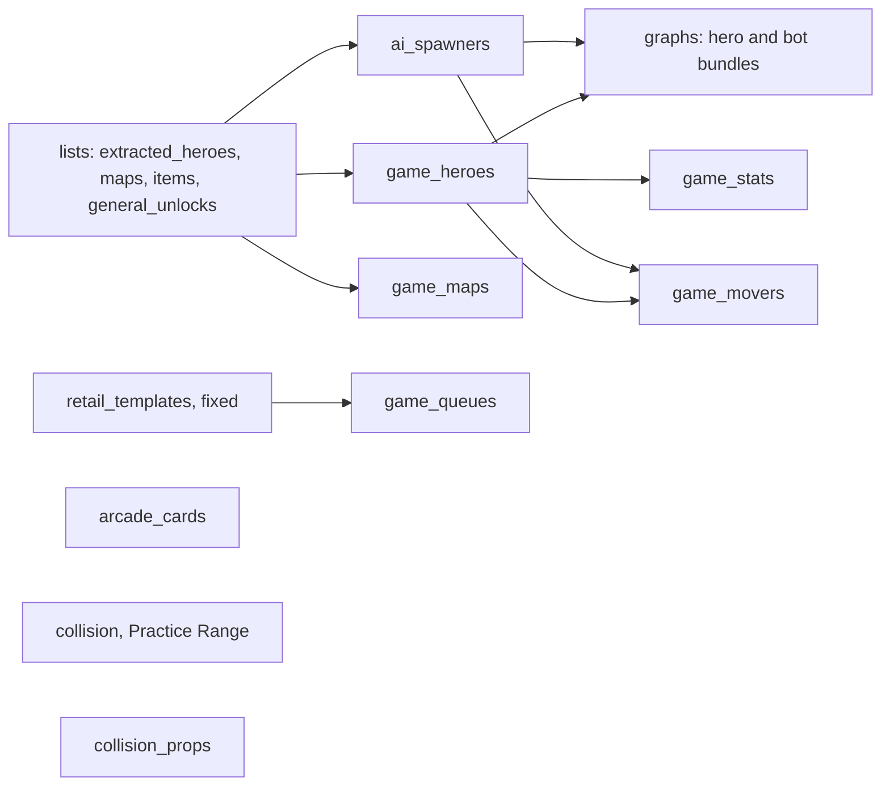

# Refactoring plan

Status: proposed, 2026-11-10.

This plan covers the repository layout, the build, the developer workflow, the user entry points, how the server gets game data, the client relay, the removal of the Python server and the replacement of the inherited documentation. This repository is a fork that is being rewritten. Nothing in this plan pushes to, or opens pull requests against, the upstream repository. Gameplay porting continues alongside this plan; after [phase D](#phase-d-replace-the-inherited-documentation), its open items live in `docs/notes/behavior.md` (in `docs/notes/parity.md` until phase 8). This plan changes where that work lives and how it is built and run. It does not change what the work must verify.

## 1. Goals

1. **Rust for everything that ships.** Two exceptions remain: the dashboard front end (JavaScript that runs in the browser) and one IDA research script (it runs inside IDA's Python).
2. **One program.** One `orpheus` binary with subcommands, one config file and one per-user state folder. Nothing is written into the checkout at run time.
3. **No prepared runtime pack.** The server reads game assets from the user's own installation (CASC) at run time. Only the fixed build data in [section 7](#7-fixed-data) stays as data files.
4. **Users build from source and run what they built.** The program never downloads anything. Cargo fetching crates during the build is the only network access.
5. **A layered Cargo workspace.** Crate boundaries enforce the dependency rules.
6. **One local check command,** `just check`, run before every change is accepted.
7. **Behavior is preserved.** After every phase, the existing tests pass and the server still starts.

## 2. Out of scope

- **CI and CD.** Phase 0 disables the workflow. Automated checks and published release binaries are a separate, later plan.
- New gameplay behavior. It continues as separate work (see `docs/notes/behavior.md` after phase D).
- Any client build other than **1.74.0.0.104319**. The code refuses other builds instead of trying to adapt.
- A WebAssembly dashboard. The existing JavaScript front end stays. This drops that item from the inherited migration plan.
- A switch to an async runtime. The `mio` event loop and worker threads stay.
- Rewriting verified logic. Phases 1 and 3 only move and split code. Phase 2 makes the small, listed changes needed to break dependency cycles.

## 3. Starting point

Measured on 2026-11-10 at upstream commit `1010ca4`. The repository was then reinitialized as a local fork. The full upstream history is saved outside the checkout as `../ORPHEUS-upstream.bundle`. Work happens in local checkpoint commits, which are squashed into one initial commit once the refactor is complete. Nothing is pushed.

| Area | Current state |
| --- | --- |
| Rust | 59,268 lines in 99 files, all in one flat `rust/src` folder of one crate. Name prefixes stand in for modules: `game_*` (21 files), `contact_*` (12), `lobby_*` (15), `script_*` (9), `mover_*` (7). `script_init.rs` has 7,539 lines. |
| Rust dependency cycles | `game ↔ script`, `game ↔ match`, `world ↔ vitals`, `runtime ↔ script_graph` and `retail_templates ↔ lobby_*`. Physics and script code import `parse_guid` from `accounts`. |
| Rust tests | 381 `#[test]` functions, 61 of them `#[ignore]`d because they need a prepared runtime. Test code reads `ORPHEUS_RUNTIME_DIR` directly in 54 places across 42 files. |
| Public build | A test fixture does `include_str!("../../data/statescript_codecs_174.json")`. That file is not in the repository, so `cargo test` cannot compile on a fresh checkout. |
| Python | `ow174/` has 38,284 lines (including the dashboard web files). There are 114 test files (29,976 lines) and 22 tool scripts plus one PowerShell script (6,119 lines). 12 tools import `ow174`. |
| Test selection | CI runs 14 hand-picked Python test modules. CONTRIBUTING lists 6 different ones. |
| Entry points | `START.bat`, `START_LOCAL.cmd` and `START_SERVER_LOCAL.cmd` all start the Python server. The Rust server needs `cargo run`, the `ORPHEUS_RUNTIME_DIR` environment variable and `--data-dir`. |
| Local state | `paths.py` writes `profile.json`, `profiles/`, `default_account.txt`, `matchmaking.json`, `game_path.txt`, `server_address.txt`, `player_name.txt`, `public_address.txt`, `logs/` and `cache/` into the checkout root. |
| Relay | The source is `relay/owwfd_relay.cpp`. `relay\build.bat` needs a Visual Studio command prompt. `relay.py` downloads a prebuilt DLL from `squeeeezy/overwatch-1.74-lobby-server`, which currently returns 404. |
| Game data | About 21 prepared files plus collision caches. They are produced by DataTool XML dumps, Python extractors, memory-dump tools and a captured server template. |
| Docs | Every document was written by the upstream authors. 16 files in `docs/` (3 Markdown, 13 plain text), plus README, a Chinese README, CHANGELOG, CONTRIBUTING, CONTRIBUTORS, CREDITS, `WIP.md`, `data/README.md` and the GitHub issue and pull request templates. Status is repeated across README, `RUST_MIGRATION.md`, `STATE.md` and `WIP.md`. `CHANGELOG.md` is 939 lines (124 KB) of daily notes. There is no architecture document. |

## 4. Target

### 4.1 Repository layout

```
ORPHEUS/
├─ Cargo.toml                  # [workspace] only
├─ crates/
│  ├─ core/                    # Guid, bit streams, tick constants
│  ├─ wire/                    # JAM lobby protocol, game link, entity records, input commands, TCP helpers
│  ├─ content/                 # typed game content: catalog, heroes, maps, stats, parameters
│  ├─ bnet/                    # Battle.net protocol, RPC, session keys, service
│  ├─ physics/                 # collision, contact solver, mover, static rays
│  ├─ script/                  # statescript graph, expressions, VM, codecs, script wire, vitals, target tags
│  ├─ sim/                     # match simulation: bodies, bots, combat, projectiles, replication, egress
│  ├─ lobby/                   # accounts, collection, templates, lobby services, match handoff
│  ├─ server/                  # process wiring: game service, connections, ingress, practice handoff, dashboard API
│  ├─ casc/                    # CASC storage and the build-104319 manifest            (phase 6)
│  ├─ stu/                     # STUv2 asset reader with the 1.74 type table           (phase 6)
│  ├─ assets/                  # game install -> content, graphs, collision; cache     (phase 6)
│  ├─ launcher/                # Windows: find, start and inject the client             (phase 5)
│  ├─ relay/                   # Windows cdylib: owwfd_relay.dll                        (phase 5)
│  ├─ fixed/                   # fixed build data, committed and embedded (section 7)
│  └─ testkit/                 # fixtures, synthetic vectors, test client, gated helpers
├─ apps/orpheus/               # the single binary
├─ justfile                    # check, lint, test, test-game, build, ...
├─ web/dashboard/              # existing JS/HTML/CSS, embedded into the binary
├─ research/ida/               # extract_statescript_codecs.py
├─ docs/
│  ├─ notes/                   # facts saved from the inherited docs (phase D)
│  ├─ user/                    # build, play, host, troubleshooting (phase 9)
│  └─ dev/                     # architecture, testing, data sources (phase 9)
├─ README.md, CREDITS.md, LICENSE
└─ START.cmd                   # builds if needed, then runs `orpheus play`
```

During the transition, `ow174/`, `tests/*.py`, `tools/`, `relay/*.cpp`, `requirements.txt` and `pyproject.toml` stay where they are. Phase 8 deletes them.

### 4.2 Crates

| Crate | Responsibility | Comes from (today's `rust/src` modules) | Lines today |
| --- | --- | --- | --- |
| `core` | `parse_guid`, `BitReader`/`BitWriter`, tick constants | `bits`, `guid`, `tick` (the last two created in phase 2) | ~550 |
| `wire` | Byte-exact encodings | `jam_cipher`, `jam_codec`, `jam_framing`, `jam_handshake`, `game_link`, `game_messages`, `game_combat_messages`, `commands`, `world` (renamed `entity`), `service_tcp`, `protocol_tests` | 4,258 |
| `content` | Typed game content and its loaders | `catalog`, `game_content`, `game_heroes`, `game_stats`, `game_parameters` | 2,184 |
| `bnet` | Battle.net emulation | `bnet_protocol`, `bnet_rpc`, `bnet_service`, `bnet_session_key` | 1,264 |
| `physics` | Collision and movement | `collision_cache`, `collision_grid`, `collision_index`, `collision_scene`, `static_ray`, `contact_*` (12), `mover`, `mover_*` (6) | 11,147 |
| `script` | Statescript | `script_graph`, `script_expr`, `script_init` (split up), `script_runtime`, `script_wire`, `script_codecs`, `script_stream`, `script_snapshot_wire`, `script_weapons`, `vitals` | ~16,200 |
| `sim` | Match simulation | `game_body`, `game_bots`, `game_combat`, `game_controller`, `game_hitscan`, `game_pools`, `game_projectiles`, `game_replication`, `game_instance`, `game_egress`, `match_scene`, `scene_assets`, `script_player` (renamed `body_script`), `projectile_flight`, `projectile_wire` | 10,321 |
| `lobby` | Lobby services | `accounts`, `collection`, `retail_templates`, `battle_tag_query`, `match_handoff`, `lobby_*` except `lobby_practice` | 8,015 |
| `server` | Wires everything into running services | `server`, `game_service`, `game_clock` (the `GameClock` type), `game_connection`, `game_ingress`, `lobby_practice`, `runtime` with `runtime/target_tags` (until phase 8; `game_data` now lists the derived files) | ~5,500 |
| `casc`, `stu`, `assets` | Reading game data from the install | new (phase 6) | — |
| `fixed` | The fixed data of section 7, embedded with `include_bytes!` | new | — |
| `launcher`, `relay` | Client start and injection | new, ported from `ow174/launcher/` and `relay/owwfd_relay.cpp` (phase 5) | — |
| `testkit` | Test support; dev-dependency only | new | — |
| `apps/orpheus` | CLI | `bin/orpheus_server.rs` and `bin/prepare_server_runtime.rs`, now the `serve` and `runtime prepare` subcommands (`runtime prepare` removed in phase 8) | — |

`world.rs` is renamed `entity` because it encodes entity create, update and movement records and the datagram limits. It is part of the wire format, not a simulation world.

### 4.3 Dependency rules

An arrow means "depends on". Cargo rejects anything else.



- `lobby` and `sim` never depend on each other. `server` connects them.
- `relay` depends on nothing in the workspace. `launcher` depends only on `core`.
- Every crate except `launcher` and `relay` keeps `#![forbid(unsafe_code)]`. In those two, every `unsafe` block carries a `// SAFETY:` comment, and `unsafe_op_in_unsafe_fn` is denied.
- `testkit` is only ever a dev-dependency.

### 4.4 How the program runs



**State folder.** `%APPDATA%\orpheus` on Windows, found with the `directories` crate so the server still builds on other systems. It contains:

| Path | Content |
| --- | --- |
| `config.toml` | Settings (below) |
| `profiles/`, `profile.json`, `default_account.txt`, `matchmaking.json` | Same names and formats as today, so existing profiles keep working |
| `logs/orpheus.log`, `logs/relay.log` | Server log. The launcher passes the relay log path to the game through an environment variable the DLL reads. |
| `cache/104319/` | Content derived from the install, keyed by content key (phase 6) |

**Settings precedence:** CLI flag > `ORPHEUS_*` environment variable > `config.toml` > default.

```toml
game = 'C:\Games\Overwatch\_retail_\Overwatch.exe'
locale = "auto"            # or zhCN, enUS, ...
account = "Player"         # replaces default_account.txt after phase 8
bind = "127.0.0.1"

[ports]
lobby = 3724               # TCP
stall = 1119               # TCP, Battle.net connection the client dials
rpc = 21119                # TCP, relay target
game = 3730                # UDP
dashboard = 3725           # TCP
```

`game_path.txt`, `server_address.txt`, `player_name.txt` and `public_address.txt` become config keys.

### 4.5 Command line

Each command ships together with the feature behind it. There are no placeholder commands.

| Command | Phase | Behavior |
| --- | --- | --- |
| `orpheus serve` | 4 | Battle.net, lobby, game and dashboard services. Stops on Ctrl+C. |
| `orpheus doctor` | 4, extended in 5 and 6 | Checks the config, the state folder, the runtime pack, the login account, free ports, the client path and build, and the relay DLL next to the binary; phase 6 adds the fixed data and the derived cache. Prints one fix for each problem and changes nothing in the state folder. |
| `orpheus state import <old checkout>` | 4 | Copies `profiles/`, `profile.json` and `default_account.txt` from a checkout into the state folder; existing files are kept unless `--overwrite`. |
| `orpheus runtime prepare` | 4 | The former `prepare_server_runtime` binary. Removed in phase 8 with the pack. |
| `orpheus play` | 5 | `serve` plus starting the client (`--BNetServer`, `--tank_Locale`) and injecting the relay built next to this binary. The game's environment tells the relay its log file and the server's RPC port. |
| `orpheus assets diff --pack <dir>` | 6 | Developer check: compares derived content with a prepared pack. |
| `orpheus script query` | 7 | Port of `tools/ssq.py`. |
| `orpheus host`, `orpheus join <address>`, `--tournament` | with their features | LAN or remote hosting and joining. They need bind addresses other than loopback, the local Battle.net emulator for joining, and matchmaking. All are migration work. |

`START.cmd` runs `cargo build --release --locked --workspace`, which also builds the relay and does nothing when the build is current, then runs `target\release\orpheus.exe play %*`. `START_SERVER_LOCAL.cmd` does the same with `serve`.

## 5. Conventions

- **Module names** drop the old prefixes: `game_bots` becomes `sim::bots`, `contact_gjk` becomes `physics::contact::gjk`, `jam_codec` becomes `wire::jam::codec`.
- **File size:** aim for under 1,500 lines. Split by concern and keep tests in separate `tests.rs` or `tests/` modules, not at the bottom of a 7,000-line file.
- **Errors:** library crates keep their typed or `io::Error` errors. Only `apps/orpheus` uses `anyhow`.
- **Logging:** `tracing`, with a file appender in the state folder. No `println!` outside the CLI.
- **CLI parsing:** `clap` with the derive API.
- **Dashboard HTTP:** `tiny_http`. It is synchronous and fits the existing thread model. The JavaScript files are embedded into the binary.
- **Developer tools:** stable Rust with the MSVC toolchain, Node.js (only for the dashboard test) and [`just`](https://github.com/casey/just). The `justfile` uses PowerShell on Windows. Every recipe is a short list of plain `cargo` or `node` commands, so each can also be run by hand.
- **Network:** the program opens only its own listeners and the relay pipe. It never downloads anything.
- **Target build:** `.build.info` is checked at startup, and any build other than 104319 is refused with a clear message.
- **Test tiers:**
  1. **Public:** `cargo test`. Synthetic fixtures only. Must pass on a fresh clone with no game installed.
  2. **Game:** marked `#[ignore = "needs game install"]` so they still appear in test listings. `just test-game` runs them (`cargo test --workspace -- --ignored`). They get the game path only through `testkit`, which reads `ORPHEUS_GAME_DIR` or the `game` key from the user's `config.toml`. Test code never reads environment variables itself. Until phase 6d, `just test-runtime` does the same with the prepared pack in `ORPHEUS_RUNTIME_DIR`.
  3. **Client acceptance:** manual, recorded in `docs/notes/behavior.md`.
- **Public repo data policy:** no client binaries, dumps, captures, keys or prepared data unless decision D1 explicitly allows a fixed-data item.

## 6. Phases



### Progress

| Phase | Status |
| --- | --- |
| 0 Groundwork | Done |
| D Docs | Done |
| 1 Module folders | Done, merged with phase 3: files moved straight into the crates, large test modules moved to `tests.rs` files, the statescript VM split into 11 files by concern |
| 2 Cut cycles | Done, before phase 1 |
| 3 Workspace crates | Done |
| 4 `orpheus` app | Done. The dashboard serves every action the Python dashboard has. |
| 5 Launcher and relay | Done. The original client reached the lobby through the Rust relay (`docs/notes/behavior.md`, 2026-11-10). The C++ relay, `build.bat`, `START.bat`, `START_LOCAL.cmd` and `--relay-dll` are deleted. `ow174/launcher` stays until phase 8, because the frozen Python server imports it; it now loads the Rust relay. |
| 6 Game data from CASC | Done. 6a: `crates/casc` reads every graph and definition from the install by GUID (`just test-game`). 6b: `crates/stu` decodes them and matches a DataTool export (`just test-datatool`). 6c: `crates/assets` derives every runtime file, each checked against the prepared pack (`just test-assets`). 6d: the server derives its data from the install into the state folder's cache on first start; it no longer reads a pack. |
| 7 Tools | IDA script moved; `fake_client` covered by test fixtures; `ssq` ported as `orpheus script query`; no other tool was needed for the parity work |
| 8 Remove Python | Done: `ow174/`, the Python tests, `tools/`, `data/`, `requirements.txt`, `pyproject.toml`, `orpheus runtime prepare` and `server::runtime` deleted; the last commit with them is tagged `python-reference`. Test classification in [section 10](#10-python-retirement) |
| 9 New documentation | Not started |

Phases 1 to 3 are mostly mechanical, but they touch every Rust file. Each step lands as a local checkpoint commit. Gameplay work continues in the new layout afterwards. The Python server stays frozen throughout and serves as the behavioral reference until phase 8.

### Phase 0: Groundwork

0. Reinitialize the repository (done 2026-11-10; see [section 3](#3-starting-point)) and record the imported tree as the first local checkpoint commit. `git mv` in phase 1 needs that baseline.
1. Delete `.github/workflows/public-checks.yml`.
2. Remove the relay download: `RELEASE_URL`, `RELEASE_SHA256` and the download path in `ow174/launcher/relay.py`, and the "downloaded by START.bat" comment in `.gitignore`. A missing DLL produces an error that points to `relay\build.bat`.
3. Replace the `include_str!` of `data/statescript_codecs_174.json` in `script_player.rs` with a small synthetic codec table committed under `rust/fixtures/`. It covers only the classes the fixture graph uses.
4. Add a `justfile` with Windows PowerShell as its shell. Its recipes:
   - `check`: `fmt-check`, `lint`, `test` and `dashboard-test`;
   - `fmt-check`: `cargo fmt --all --check`;
   - `lint`: `cargo clippy --workspace --all-targets --locked -- -D warnings`;
   - `test`: `cargo test --workspace --locked`;
   - `dashboard-test`: `node --test web/tests/test_dashboard_client.mjs` (in `tests/` until phase 8);
   - `test-runtime`: the ignored tests against a prepared pack (until phase 6d).

   Python is not part of `just check`. When a phase changes Python code (phase 0 changes `relay.py`), the affected Python tests are run by hand once.

   Phase D's new README points to `just check`.

**Done when:** `just check` passes on a fresh clone with no game, no runtime pack and no network access beyond Cargo's crate fetch.

### Phase D: Replace the inherited documentation

All existing documentation was written by the upstream authors, and the fork keeps none of it. This phase saves the facts the rewrite needs into a few short notes and deletes everything else. It runs right after phase 0, so every later phase works from the new notes. The deleted files remain in the upstream history bundle (`../ORPHEUS-upstream.bundle`) if something turns out to be missing.

**What to keep:** facts the code or this plan depends on. That means numbers and limits, client addresses and offsets, wire layouts, pinned tool revisions, what each data file is for and how it is made, verified behavior, known defects, acceptance targets, and the legal notices.

**What to drop:** upstream process (contribution lanes, review and audit workflow, AI-disclosure rules, issue forms), status narratives, the daily changelog, conclusions the upstream authors themselves retracted or superseded, and the specs of Python-only research formats.

Each kept fact is rewritten briefly, in our own words. Where it matters, the note says what the fact was observed on (for example "client 104319, offline extraction"). Upstream session names and dates are not kept.

**New notes in `docs/notes/`:**

| Note | Content | Taken from |
| --- | --- | --- |
| `protocol.md` | Datagram and payload limits, the verified raw statescript payload layouts, handshake facts, default ports, relay offsets, client structural evidence | `PACKET_BUDGET.txt`, `RAW_PAYLOADS_174.txt`, `RESEARCH_EVIDENCE.txt` §A–B, the rules in `SIMULATION_CONTRACT.txt` that the Rust worker implements, the port list in `RUST_MIGRATION.md` |
| `data-sources.md` | Each data file: its purpose, how it is derived and from which asset types. The fixed-data list. The pinned OWLib and TACTLib revisions, the DataTool offline settings and the graph bundle hash. | `data/README.md`, `RESEARCH_EVIDENCE.txt` §I, [section 7](#7-fixed-data) |
| `behavior.md` | Acceptance targets M0–M6, behavior seen with the original client, known defects and open questions. Client acceptance records are added here from now on. | `docs/ROADMAP.md`, `docs/STATE.md`, `WIP.md`, the README status table |
| `parity.md` | What the Python server does that the Rust server doesn't yet, plus the cutover criteria. Deleted in phase 8; its evidence and open items moved to `behavior.md`. | `docs/RUST_MIGRATION.md`, the Python CLI modes |
| `references.md` | External projects and notes still worth consulting, one line each on what they're useful for | `RESEARCH_EVIDENCE.txt` §C–H (without the retracted conclusions), `CREDITS.md` |
| `related-projects.md` | Every useful finding from the other 1.74 projects (match flow, AI and navigation, HUD, statescript names, lobby), with source and evidence | The 2026-11-10 survey of the projects in the original `CREDITS.md` and ow1-preservation |
| `game-rules.md` | Match, combat and progression rules from public sources | ow1-preservation's `research_notes/` |
| `ow1-preservation.md` | Every fact from ow1-preservation's notes and protocol layouts (HUD, prediction and reset bit, Recall, Blink, two clients, AI, modes) | Its `HANDOFF.md`, `CLAUDE.md`, `docs/` and `protocol/` |

**Legal files:**

- `LICENSE` stays unchanged. The MIT license requires keeping its copyright and permission notice in copies of the software, and the fork still contains upstream code. You can add your own copyright line.
- `CREDITS.md` is replaced by a short attribution list. It names the upstream projects whose code remains: the Boi-027 lobby research with Arlecchino's copyright, the LizRollin runtime branch, and the authors of the community TLS relay. Third-party code ported later (TACTLib and OWLib, both MIT) is added when it lands. The research thanks and the dependency list are dropped; `Cargo.lock` already lists the dependencies.

**Fate of every inherited document:**

| File | Fate |
| --- | --- |
| `README.md` | Rewritten: what the fork is, how to build, run and check. Phase 9 expands it. |
| `README.zh-CN.md`, `CHANGELOG.md`, `CONTRIBUTING.md`, `CONTRIBUTORS.md` | Deleted. The build and check commands move into the new README. The changelog history stays in git. |
| `CREDITS.md`, `LICENSE` | See legal files above |
| `WIP.md`, `docs/ROADMAP.md`, `docs/STATE.md` | Extracted into `behavior.md`, then deleted |
| `docs/RUST_MIGRATION.md` | Extracted into `parity.md`, `behavior.md` and `protocol.md`, then deleted |
| `docs/RESEARCH_EVIDENCE.txt` | Extracted into `protocol.md`, `data-sources.md` and `references.md`, then deleted |
| `docs/PACKET_BUDGET.txt`, `docs/RAW_PAYLOADS_174.txt`, `docs/SIMULATION_CONTRACT.txt` | Extracted into `protocol.md`, then deleted |
| `data/README.md` | Extracted into `data-sources.md`, then deleted |
| `docs/CONTROLLED_SERVER_JOURNAL_V1.txt`, `…_V2.txt`, `BODY_VM_SNAPSHOT_V1.txt`, `PHYSICS_SNAPSHOT_V1.txt`, `ENVIRONMENT_READ_TAPE_V1.txt`, `COLLISION_READ_TAPE_V1.txt`, `LOCAL_REPLAY_MANIFEST_V1.txt`, `NATIVE_BODY_REPLAY_V2.txt`, `SERVER_STORED_STATE_V1.txt` | Deleted without extraction. They specify Python-only research formats that no Rust code reads. |
| `data/replays/README.txt` | Deleted in phase 8 together with `data/replays/basic.json`, the Python replay fixture it describes |
| `.github/ISSUE_TEMPLATE/*` (4 files), `.github/PULL_REQUEST_TEMPLATE.md` | Deleted. Whether and how the fork takes issues and pull requests belongs to the later CI/CD plan. |
| `docs/REFACTOR.md` | Stays as the working plan, with its links pointed at the new notes. Phase 9 turns its lasting parts into `docs/dev/architecture.md` and deletes it. |

**Code comments are not part of this purge.** Some research knowledge exists only in Python and tool docstrings: the CASC layout in `ow174/game/casc.py`, the ENTITY chunk layout in `extract_ai_spawners.py`, and the placeable rules and client addresses in `extract_game_maps.py` and `extract_statescript_codecs.py`. Phase 6 carries it into the doc comments of the Rust code that replaces each tool, and phase 8 checks that before deleting `tools/` and `ow174/`.

**Done when:**
- the only documents left are `README.md`, `LICENSE`, `CREDITS.md`, `docs/REFACTOR.md`, `docs/notes/*` and, until phase 8, `data/replays/README.txt`;
- every link in this plan points to an existing file;
- every fact this plan cites from an inherited document is in a note;
- `git grep -n -E "docs/|docs\\\\|STATE\.md|RUST_MIGRATION|RESEARCH_EVIDENCE|CONTRIBUTING|WIP\.md|ROADMAP|data/README"` finds no reference to a deleted file anywhere in the code or scripts. Today there is one: `START_LOCAL.cmd` points to `docs\STATE.md`. The two Rust references to `CREDITS.md` (`jam_cipher.rs`, `jam_codec.rs`) stay valid because that file is kept.

### Phase 1: Module folders (moves only)

1. Use `git mv` to move `rust/src/*.rs` into folders named after the future crates (`core/`, `wire/`, `content/`, `bnet/`, `physics/`, `script/`, `sim/`, `lobby/`, `server/`), following the table in [4.2](#42-crates). Drop the name prefixes. Rewrite the `use` paths. Keep `pub use` re-exports only inside the commit that needs them, and remove them before the phase ends.
2. Move inline test modules of more than about 300 lines into sibling `tests.rs` files.
3. Split `script_init.rs`:
   - production code (lines 1–4,748, with the VM `impl` at 1,102–4,607) goes into `script/vm/` under `mod.rs`, `component.rs`, `machine.rs`, `events.rs` and `context.rs`, plus one file per group of state kinds;
   - its tests (lines 4,749–7,539) go into `script/vm/tests/`, split by topic.

   Apply the same treatment to the other files over 1,500 lines: `script_snapshot_wire.rs`, `game_replication.rs`, `game_service.rs`, `script_expr.rs`, `script_player.rs`.

**Done when:** the same 381 tests exist, the same 61 are ignored, `just check` passes, and every move was made with `git mv`.

### Phase 2: Cut the dependency cycles (done)

Phase 2 ran before phase 1: cutting the edges first made the later moves pure moves. A scan of every `crate::` path, test modules included, with the 4.2 assignment applied, found the edges below. Each was fixed until the scan reported none. The scan was a one-off script and isn't kept; from phase 3 on, Cargo enforces the rules.

| Cut | Wrong-way edge | Change |
| --- | --- | --- |
| C1 | 11 modules in `physics`, `script`, `content` and `sim` use `accounts::parse_guid` | `parse_guid` moved to the new `guid` module (`core`). All uses import it from there. |
| C2 | `script_runtime`, `script_stream`, `game_bots`, `game_projectiles`, `game_replication`, `projectile_flight` and `scene_assets` use the `game_clock` tick constants | `TICK_PERIOD`, `SEND_EVERY`, `FIRST_TICK` and `MAX_LEASE_FRAME` moved to the new `tick` module (`core`). |
| C3 | `game_clock` uses `game_connection::{HANDOFF_TIME, LEAVE_GRACE}` | After C2 only `game_service` uses `game_clock`, so it goes to `server`. Placement only. |
| C4 | `world::health` calls `vitals::Vitals::with_current_health` (wire to script) | `health()` moved to `vitals`. The `world` test that used it builds the pool component directly. |
| C5 | `script_player` uses more than 20 `game_*`, `match_*` and `mover*` modules | Placed in `sim`. Placement only. |
| C6 | `game_replication` uses `game_egress` | `game_egress` placed in `sim`. Placement only. |
| C7 | `lobby_practice` uses `game_service`, `match_scene` and `scene_assets` | Placed in `server`. Its message identity (`GAME_REQUEST`, `CREATE_GAME`, `is_request`) moved to `match_handoff` (`lobby`), which the lobby tests use. |
| C8 | `script_init` tests use `game_hitscan::HitDefinition` and `projectile_flight::ProjectileBallistics` | The authored damage and ballistics definitions (`HitDefinition`, `DamageFalloff`, `ProjectileBallistics`, `Blast`, `authored_number`) moved to the new `script_weapons` module (`script`). Hit detection and flight stay in `sim`. |
| C9 | `lobby_session` tests start the whole native server; `mover_correction` tests use `game_egress` | The native server test moved to `server`, the correction-and-egress test to `game_egress`. The client side of the lobby handshake became a shared test helper in `jam_handshake`; phase 3 moves it to `testkit`. |

`runtime::target_tags` only depends downward on `script_graph`, so it stays with `runtime`. The `retail_templates ↔ lobby_{arcade,login,passes,transport}` cycle stays inside the `lobby` crate and doesn't block anything.

**Done when:** the scan reports no wrong-way edges and `just check` passes.

### Phase 3: Workspace crates and testkit

1. Turn each folder into a crate under `crates/`. Name each package `orpheus-<name>`. Use workspace-level `[workspace.dependencies]`, lints and `rust-version`.
2. Move `bin/orpheus_server.rs` to `apps/orpheus`. `prepare_server_runtime` became `orpheus runtime prepare` in phase 4.
3. Create `testkit`:
   - one function that returns the prepared-pack path (later the game path) or panics with instructions, replacing the 54 direct environment reads;
   - shared synthetic fixtures;
   - shared builders such as `fixture_body_factory`.
4. Add `just test-runtime` support to `testkit`: the ignored tests find the prepared pack through `testkit` only.

**Done when:** every crate builds and tests on its own (`cargo test -p orpheus-<name>`), and the workspace test count and ignored count match phase 1.

### Phase 4: The `orpheus` app

1. Build the CLI from [4.5](#45-command-line): `serve`, `doctor` and `state import`, using `clap`, `tracing`, the config precedence and the state folder.
2. Add the dashboard backend in `server`:
   - serve the embedded `web/dashboard` files, moved from `ow174/dashboard/web`;
   - implement each route the native server can back with real behavior;
   - routes whose feature isn't ported yet return `501 Not Implemented` with the feature name, and are tracked in the parity list in [section 10](#10-python-retirement).

   The Python server has these routes:
   - `GET`: `/api/state`, `/api/status`, `/api/collection`;
   - `POST`: `/api/apply_to_all`, `update_profile`, `add_boxes`, `open_all_boxes`, `bot_group`, `purchase`, `grant_skin`, `select_account`, `default_account`, `set_frame`, `reconnect`, `start_game`, `matchmaking`, `mode_settings`, `set_map`, `end_matches`.
3. Replace `START_SERVER_LOCAL.cmd` with `orpheus serve`.

**Done when:**
- `orpheus serve` starts from a fresh state folder after `state import`;
- `doctor` reports a deliberately broken setup correctly (wrong port, missing pack, missing profile);
- the dashboard test passes against the embedded files.

### Phase 5: Launcher and relay in Rust

**Launcher** (`crates/launcher`, Windows only). Port `ow174/launcher/`:

- find and validate the client, from config or a file picker;
- detect the locale and pass `--tank_Locale`;
- close a running copy, then start the client;
- inject with `OpenProcess`, `VirtualAllocEx` and `CreateRemoteThread` plus `LoadLibraryW`, resolving the remote export through its owning module as `inject.py` does;
- map TCP connections to process IDs (`GetExtendedTcpTable`) so the Battle.net emulator can tell two clients on one PC apart.

The launcher loads `owwfd_relay.dll` from the same folder as `orpheus.exe`. `cargo build --workspace` builds both into the same output folder, so the launcher injects the DLL from the same build. `orpheus play` checks the install's `.build.info` version and refuses any build other than 104319; `--game` (or `ORPHEUS_GAME`, or `game` in `config.toml`) names the install, and `locale` picks the game language. The second-game helpers (`GetExtendedTcpTable` connection owners for the dashboard's `start_game`) wait for that dashboard action.

**Relay** (`crates/relay`, a `cdylib` built with `windows-sys`). Port `relay/owwfd_relay.cpp` behavior for behavior:

| C++ | Rust |
| --- | --- |
| `DllMain` starts a worker with `CreateThread` | Same, calling `CreateThread` directly. `DllMain` does nothing else. |
| `__try/__except` around reads of arbitrary heap memory (`rd64`, `rd32`, the region scan, the vtable writes) | Rust cannot catch access violations. Read with `ReadProcessMemory(GetCurrentProcess(), …)` into local buffers, region by region, after the same `VirtualQuery` filter (committed, private, read-write, not a guard page, at most 128 MiB). Write the two vtable pointers with `WriteProcessMemory` on the own process. Both return an error instead of crashing the game. |
| Thunks for `send` (slot 3), `recv` (slot 2) and the byte-stream state (slot 1) | `extern "system"` functions. Each body runs inside `catch_unwind` and falls back to the C++ result: `send` reports the full length sent, `recv` reports 0 bytes, `state` returns 1. A panic must never reach the game. |
| Constants: byte-stream vtable RVA `0x298E2F8`, offsets `+0x20`, `+0x48`, `+0x80`, `+0x88`, `+0xA8`, vtable copy of 64 slots, target `127.0.0.1:21119`, 8 ms scan loop, 30 ms `recv` wait | Same values, as named constants with the C++ comments. |
| `CRITICAL_SECTION` plus a fixed 64-entry relay table whose entries are never removed, so byte-streams after the 64th get no relay | `Mutex` around the same 64-entry table. Keep the same behavior until the live test passes, then remove entries when a stream closes, as a separate change. |
| Log at `<dll folder>\log\wfd.log` | Log path from an environment variable set by the launcher, falling back to the old location |
| Header comment mentions "the Go bnet server" and port 1119 | Corrected: the relay pipes to the native Battle.net RPC listener on 21119 |

`cargo build --release` builds `orpheus.exe` and `owwfd_relay.dll` into the same folder.

**Gate:** keep `relay/owwfd_relay.cpp`, `relay/build.bat` and the Python launcher until the Rust DLL passes a live test. The original client must log in through the Rust relay and reach the lobby, recorded in the status doc with commit, build and steps. Until then, `orpheus play --relay-dll <path>` can use the C++ build for comparison. After the gate passes, delete the C++ relay and that flag.

**Done when:** `START.cmd` → `orpheus play` gets the original client into the lobby with the Rust relay, and `START.bat` and `START_LOCAL.cmd` are deleted.

**Result (2026-11-10):** done. `ow174/launcher` is not deleted with the C++ relay as planned: `ow174/lobby/server.py`, `ow174/dashboard/service.py` and `ow174/cli.py` import it, and the Python server stays runnable as the reference until phase 8. It loads `target\release\owwfd_relay.dll` instead.

### Phase 6: Game data from CASC at run time

DataTool has already read everything the pack needs from the local install, fully offline, with online and CDN fallback disabled (`docs/notes/data-sources.md`). This phase reimplements the part of DataTool, TACTLib and the extractors that the server uses. TACTLib and OWLib are MIT-licensed on their default branches. Confirm this for the pinned revisions, and add the ports to `CREDITS.md`.

**6.0 Spike (go/no-go).** In a scratch crate, read one statescript graph (`01B`) and one entity definition (`003`) by GUID from the real install, through the 104319 manifest (TACTLib `ProCMF_104319.cs`, revision `a00459fe`). Compare the bytes with what DataTool exports for the same GUIDs. If the manifest decryption can't be ported, stop phase 6 and keep the prepared pack. Phases 0 to 5 and 7 don't depend on this phase.

**6a. `casc` crate:**
- `.build.info` and config;
- local `.idx` indices and `data.NNN` archives;
- BLTE blocks: stored and zlib, as `casc.py` already handles, plus encrypted blocks if the spike finds any needed asset uses them;
- the encoding table;
- the TRG/CMF manifest for 104319 only.

Public tests use a synthetic miniature storage built by `testkit`.

**Spike result (2026-11-10):** go. TACTLib's `ProCMF_104319` decrypts the install's manifests, and the GUID counts match DataTool's extraction (1,587 `01B`, 3,528 `003`). Encrypted blocks are needed: 8 bundles use them, so the reader handles Salsa20 with the install's keyring. One key is missing from that keyring; TACTLib's static keyring has it, and `docs/notes/data-sources.md` lists what it unlocks.

**6b. `stu` crate:** an STUv2 reader. A one-off generator (`cargo run -p orpheus-stu --bin gen-types`) reads OWLib's `overwatch/1.74` `TankLib/STU/Types` (revision `7afe5f52`) and writes a Rust type table, which is committed. The table is derived from MIT-licensed code, not from game data.

**6b result (2026-11-10):** done. The generator writes a text table (`crates/stu/data/types.txt`: 5,255 classes, 14,194 fields, 512 enums, 2,106 declared defaults) that the crate embeds and parses once, instead of Rust source; that keeps compile times down. The reader fills unstored fields with their defaults, as DataTool shows them. It decodes all 1,587 graphs, 3,528 definitions and 25 game modes (with the static key of 6c; 1,586 and 3,509 with the install's keyring alone); 152 graph instances are of classes OWLib doesn't know, which DataTool exports as null too. Against a DataTool XML export of the same install, every graph's item list matches, and all 1,167,080 numbers, nulls and strings DataTool prints on the graph roots, graph items and definition roots are equal.

**6c.0 Classify the inherited files.** No script in the repository produces `extracted_heroes.json`, `extracted_maps.json`, `extracted_items.json`, `extracted_general_unlocks.json`, `collision_keys_174.json` or `collision_props_174.json`. They most likely came from dumps taken while the live servers were still running. Their origin isn't tracked further. Other extractors read them as inputs: `extract_game_heroes.py` and `extract_ai_spawners.py` take hero names from `extracted_heroes.json`, `extract_game_maps.py` takes English map names from `extracted_maps.json`, and `extract_ai_spawners.py` and `build_collision.py` take storage keys from `collision_props_174.json` and `collision_keys_174.json`. Before porting anything in 6c, inspect each file and classify it:

- **derive:** its content can be found in the install's assets. Write a derivation with the existing file as its oracle;
- **not needed:** the manifest makes it unnecessary, which is expected for the two collision key files;
- **fixed:** it can't be reproduced from the install, so it moves to [section 7](#7-fixed-data).

Record the result in `docs/notes/data-sources.md`.

**6c. `assets` crate:** derivations that produce `content`, `script` and `physics` types directly. Each one is checked with `orpheus assets diff` against its existing pack file before the server uses it:

| Output (oracle file) | Source today | Asset inputs |
| --- | --- | --- |
| `extracted_heroes.json`, `extracted_maps.json`, `extracted_items.json`, `extracted_general_unlocks.json` | None in the repository (see 6c.0) | Derived: a port of DataTool's `list-heroes`, `list-maps`, `list-unlocks` and `list-general-unlocks --json` (`crates/assets/src/lists`), identical to DataTool's own output on this install. The pack's maps file has 207 blank or season-less display strings the install doesn't; the test pins them. |
| `game_heroes_174.json` | `extract_game_heroes.py` | `075` plus hero names |
| `game_graphs_174.json.gz` | `extract_game_graphs.py` | `01B`, `003`, `0C5` (mode variables), the AI spawner graphs. Oracle: the normalized SHA-256 `febfbcc8…` recorded in `docs/notes/data-sources.md`. |
| `game_maps_174.json` | `extract_game_maps.py` | `003`, `09F`, `0C5`, raw map chunks `0BC`, map entities, strings |
| `game_queues_174.json` | `extract_game_queues.py` | `0C7`, `0C0`, `0C5`, `039`, `09F`, `0D9`, `0EE`, `0CC`, strings `07C`, plus the captured fields in [section 7](#7-fixed-data) |
| `arcade_cards_174.json` | `extract_arcade_cards.py` | `0C7`, plus the server-set fields in section 7 |
| `game_movers_174.json` | `extract_game_movers.py` | `003` (`STUCharacterMoverComponent`) |
| `game_stats_174.json` | `extract_game_stats.py` | `054`, `075`, `062` |
| `ai_spawners_174.json` | `extract_ai_spawners.py` | Map ENTITY chunks (`0x0B`), `075` |
| `collision_keys_174.json`, `collision_props_174.json` | None in the repository (see 6c.0) | Keys: not needed, the manifest resolves the chunks. Props: only `modes` (which placeables each mode keeps) is read; the `collision_props` derivation writes it from the map ENTITY chunks. |
| Collision `.col` and `.rays.col` caches | `build_collision.py` (with `ow174.game.casc`, `collision`, `props`) | Map collision chunks and prop models. Write the existing `.col` format, so `physics::collision_cache` stays unchanged. |
| Raycast metadata, score events | `extract_raycast_metadata.py`, `extract_game_stats.py --score-events` | `097`, `098`, `054` |

The derivations depend on each other, and are ported and run in this order. An arrow means "is an input to".



**6c result (2026-11-12):** done. `crates/assets` has 11 derivations, run in the order above (`DERIVATIONS`). Each is tested against its pack file (`just test-assets`); all match except where the test pins a known difference with its cause: 207 display strings of `extracted_maps.json` (the pack's copy wasn't made from this install's strings; built from them, `game_maps_174.json` names five lobby maps by their names, where the pack has their internal ones), the bytes of `0688.col` (6 more empty models, because the derivation also reads models stored in bundles), and `collision_props_174.json` (only `modes` is written). `orpheus_assets::collision_cache` builds any other map's cache. A full derivation takes about 1 min 50 s in a release build.

**Caching:** results go to `<state>/cache/104319/`, stamped with the build version, build config key, locale and `DERIVATIONS_VERSION`; another stamp derives them again. Collision for a map other than the Practice Range is built when a match on that map first starts. The first launch is slower; later launches read the cache.

**Locale:** read the installed locale, which was zhCN in the recorded extraction. Server logic keys only on GUIDs. Display names are used only for logs and the dashboard.

**6d. Switch:** the server takes `game` from config, and `doctor` checks the build. The Rust server stops reading `ORPHEUS_RUNTIME_DIR`. Game-tier tests switch from the pack to `just test-game`, and `just test-runtime` is removed. The pack format, `orpheus runtime prepare` and the Python extractors stay until phase 8, because the frozen Python server still reads the pack and the pack is the oracle for 6c.

**6e (optional).** Dashboard item previews come from `export_item_previews.py` and DataTool PNG exports. They could later be decoded from CASC textures. This needs a texture decoder and is not required for cutover.

**Done when:** a fresh state folder plus a game install, with no pack, serves the Practice Range path the Rust server serves today, and every derivation matches its oracle file.

### Phase 7: Tools

| Tool | Fate |
| --- | --- |
| `fake_client.py` | Covered: the client side of the lobby handshake is the `client_handshake` fixture in `orpheus-wire` (feature `fixtures`), and the server's loopback test logs in, decodes the login messages and loads the Practice Range with it. Delete in phase 8. |
| `ssq.py` | Ported as `orpheus script query` (`apps/orpheus/src/script_query`): every subcommand and output, read from the derived graph bundle and the embedded names catalog. Its output matches `ssq.py` on the same bundle, except the `class` command's `VM:` line, which describes the Rust VM's state kinds and node actions instead of the Python registries. `tests/test_ssq.py` is ported as game-tier tests there. Delete in phase 8. |
| `extract_statescript_codecs.py` | Moved to `research/ida/` (done). It runs inside IDA. |
| `build_collision.py`, `extract_*.py`, `dump_schemas.py`, `export_casc_records.ps1`, `prepare_server_runtime.py` | Replaced by phase 6. Delete in phase 8. |
| `replay_game_commands.py`, `replay_native_body.py`, `probe_body_script.py`, `probe_practice.py`, `analyze_game_graphs.py`, `codec_coverage.py`, `export_item_previews.py` | They inspect or compare against the Python implementation. Delete in phase 8. Rewrite one on the Rust crates only if a concrete need comes up. |

### Phase 8: Remove Python

**Gate:** the cutover criteria and the feature list in `docs/notes/parity.md` (see [section 10](#10-python-retirement)), plus passed gates in phases 5 and 6.

1. Classify each of the 114 Python test files in `docs/notes/parity.md` as one of:
   - covered, naming the Rust test;
   - ported, naming the new Rust test;
   - dropped, with the reason (for example, it tests a Python-only research format).

   Port `tests/golden/messages.json` (lobby content golden data, used by `test_content_golden.py`) to a Rust lobby test.
2. Delete:
   - `ow174/`, `tests/*.py`, `tools/`, `data/` (the replay fixture and its README);
   - `requirements.txt`, `pyproject.toml`;
   - `orpheus runtime prepare`, `server::runtime` and `just test-runtime`.
3. Move the old `profiles/` layout handling entirely into `state import`.
4. Check that the research knowledge in the Python docstrings named in phase D now lives in Rust doc comments. Then delete `docs/notes/parity.md`, and record the final client acceptance results in `docs/notes/behavior.md`.

**Done when:** the repository contains no `.py` files outside `research/ida/`, and `just check` passes.

### Phase 9: New documentation

All documentation from here on is written for this fork.

| Document | Content |
| --- | --- |
| `README.md` | What the project is, a three-step quick start (build, `orpheus doctor`, `orpheus play`) and links to the docs below |
| `docs/user/` | Building from source (Rust and the MSVC Build Tools), first run and `state import`, playing, hosting and joining, `doctor` messages and troubleshooting |
| `docs/dev/architecture.md` | Crates, dependency rules, data flow and the state folder, taken from section 4 of this plan |
| `docs/dev/testing.md` | The test tiers and the `just` recipes |
| `docs/dev/data-sources.md` | Moved from `docs/notes/data-sources.md` once phase 6 is finished |
| `docs/notes/` | `protocol.md`, `behavior.md` and `references.md` remain as research reference |
| `CHANGELOG.md` | Starts with the first release, under the later CI/CD plan |

Each earlier phase updates the README when it changes how the program is built or run. Phase 9 finishes the set and deletes this plan.

## 7. Fixed data

These inputs are not game assets, so CASC cannot provide them. They are fixed for build 104319 and never change. Most likely they came from client dumps and traffic taken while the live servers were still running. The first seven and the research names are committed in `crates/fixed/data` (decision D1) and embedded in the binary; `docs/notes/data-sources.md` records their source and SHA-256.

| Item | File | Why it can't come from CASC |
| --- | --- | --- |
| Lobby message schemas | `lobby_schemas.json` | Field layouts of compiled C++ message classes, read from a running client by `dump_schemas.py` |
| Game link schemas | `game_schemas.json` | Same, with `--game-link` |
| Statescript payload codecs | `statescript_codecs.json` | What the client's reader code reads per state class, extracted with IDA from a client memory image |
| Battle.net descriptors | `bnet_descriptors.pb` | Protobuf descriptors compiled into the client |
| Lobby state-blob key | `lobby_state_blob.key` | A 64-byte constant of the build's handshake |
| Captured server templates | `retail_templates.json` | Server-side data, decoded from 1.68 reference traffic. It was never in the client. |
| Event resource keys | `resource_keys.json` | The server sends them to the client (`lobby_celebrations`). Treated as server-side data; whether the install also contains them is unverified (D2). |
| Server-set queue and Arcade card fields | Parts of `game_queues_174.json` and `arcade_cards_174.json` | `extract_game_queues.py` reads the captured templates. Arcade card duration and permanence are set by the server, not the card asset. |
| Rules from client code used by derivations | Constants in the extractors, for example the placeable type flag table in `extract_game_maps.py` | Facts about compiled code. They become Rust constants in `assets`. |
| Research names | `statescript_names.json` | Research-only naming catalog (class aliases, the STU fields that hold a variable, logical buttons, the hero select and HUD graphs, each mode's scripts, the server's variable names), used by `orpheus script query`. Upstream research (LizRollin's `statescript_names_174.json`), not read from the client. |

The captured templates should become authored server content: TOML files a server owner can read and edit, generated once from `retail_templates.json`.

## 8. Decisions

### Decided

| Decision | Result |
| --- | --- |
| CI and CD | Out of scope. The workflow is deleted in phase 0 and comes back in a later plan. |
| Binaries | Users build from source. The launcher injects only the DLL from the same build. |
| Relay | Ported to Rust. The C++ version stays until the live login test passes. |
| Game data | Read from CASC at run time, except the fixed data in section 7 |
| Tools | Ported (`fake_client`, `ssq`), kept as research (the IDA script) or deleted |
| Dashboard | The JavaScript front end stays. The backend moves to Rust. No WebAssembly. |
| Runtime | No async runtime. `mio` and worker threads stay. |
| Target | Build 104319 only |
| D1 Fixed data | Committed to `crates/fixed/data` and embedded in the binary (decided 2026-11-10). The repository owns the files, so names and formats may change. |

### Open

| ID | Question | Options | Needed before |
| --- | --- | --- | --- |
| D2 | Can `resource_keys_174.json` be derived from the install? | Check during the 6.0 spike. If the install does contain the keys, the item moves out of section 7. | Phase 6d |

## 9. Risks

| Risk | Effect | Mitigation |
| --- | --- | --- |
| The 104319 manifest (TRG/CMF) port fails | No runtime parsing | 6.0 spike first. Phases 0–5 and 7 don't depend on it, and the prepared pack remains the fallback. |
| Needed assets are encrypted with keys not present locally | Some derivations impossible | Found by the spike. Missing items go to section 7. |
| STU type table incomplete for some types | Wrong or missing fields | Each derivation must match its oracle file before use |
| Collision builder port differs from Python | Movement and hit differences | Write the same `.col` format and compare caches byte for byte |
| Rust relay misbehaves inside the client (no SEH, game threads) | Client crash or no login | Safe reads and writes through the process memory API, `catch_unwind` in every thunk, the C++ DLL kept until the live test passes |
| First-start derivation is slow | Poor first impression | Per-map lazy collision, a persistent cache and progress in the log |
| Large moves are hard to review | Lost or hidden changes | Phases 1–3 move code with `git mv` only, one checkpoint commit per crate group. Logic changes are limited to the phase 2 cuts. |
| Python cutover gate depends on unported gameplay | Python stays longer | Phases 0–7 don't need Python removed. Phase 8 waits for parity. |
| A fact is lost in the docs purge | Rework or a wrong assumption | Phase D's per-file table and its done-when check. The originals stay in the upstream history bundle. |

## 10. Python retirement

The Python server stays the frozen reference until these work in Rust and are verified with the original client. The list comes from the inherited migration plan (`docs/notes/parity.md` after phase D) and the Python CLI:

- matchmaking queues and PvP modes beyond the solo Practice Range;
- social actions;
- the dashboard routes listed in phase 4;
- host mode (bind beyond loopback), join mode (local Battle.net emulator pointing at a remote lobby) and tournament mode;
- the relay and launcher workflow (phase 5);
- runtime pack replacement (phase 6).

Phase 8 moved the final per-feature evidence and open items from `docs/notes/parity.md` to `docs/notes/behavior.md` ("Server coverage and open items") and deleted the parity note. The client acceptance results stay in `behavior.md`.

### Python test classification

Each of the 114 Python test files (at the tag `python-reference`): 78 covered by an existing Rust test, 10 ported to new Rust tests, 26 dropped. Covered tests marked "ignored" run only in the game tier (`just test-game`, `just test-assets`). The dashboard's JavaScript test stays, as `web/tests/test_dashboard_client.mjs`; `tests/golden/messages.json` moved to `crates/lobby/tests/golden/`.

The last differing test, `TakeOutTests::test_a_player_taken_out_before_his_game_connects...` in `test_leaving.py`, is ported too: the Rust server now behaves as Python did.

| Python test | Class | Rust test or reason |
| --- | --- | --- |
| `test_accounts.py` | covered | lobby `accounts.rs`: `accounts_keep_nicknames_and_identity_across_restarts`, `starter_boxes_and_ids_match_the_python_profile` |
| `test_arcade.py` | covered | lobby `arcade.rs`: `rotation_counts_groups_instead_of_cards_and_deduplicates_events`, `arcade_and_pass_wire_bytes_match_python_across_events_seasons_and_dates` (ignored) |
| `test_battle_tag_query.py` | covered | lobby `battle_tag_query.rs::gets_the_host_nickname_and_leaves_a_game_hello_unread`; `session/tests.rs::answers_battle_tag_queries_without_creating_unknown_accounts`; app `join.rs::the_battle_tag_comes_from_the_server_and_an_old_server_is_named`, `an_unreachable_server_is_named` |
| `test_bnet_auth.py` | covered | bnet `rpc.rs::connect_logon_and_referral_match_the_python_rpc_frames`; `session_key.rs::session_key_keeps_the_reference_marker_and_utf8_bytes` |
| `test_body_probe_cli.py` | dropped | Tests `tools/probe_body_script.py` (research probe over `research_runtime`); the tool is deleted in phase 8 |
| `test_body_vm_aliases.py` | dropped | Python VM snapshot alias identity (format BODY_VM_SNAPSHOT_V1, deleted); no Rust reader |
| `test_body_vm_snapshot.py` | dropped | Same Python-only body VM snapshot research format |
| `test_bot_chat.py` | ported | server `lobby/social/tests/bot_chat.rs`: `the_bot_is_quiet_by_default`, `the_bot_answers_when_the_switch_is_on` |
| `test_bots.py` | covered | sim `bots/tests.rs`: `backward_walk_brake_and_next_leg_match_python_wire_vectors`, `catalogs_only_unconditional_spawners...`, `fifteen_practice_bots_match_python_roster_and_patrol_frames` (ignored) |
| `test_casc_bundle.py` | covered | casc `tests/storage.rs::reads_stored_and_bundled_assets_by_guid`, `damaged_bytes_fail_their_content_key`; `bundle.rs::reads_each_offset_width` |
| `test_cli.py` | covered | app `ask.rs::the_mode_menu_takes_a_number_and_enter_is_retail`, `answers_are_remembered_and_enter_reuses_them`, `addresses_and_names_are_checked_like_the_reference`; `main.rs::bad_join_options_are_refused_before_anything_starts`; `settings.rs` tests |
| `test_collision_fingerprint.py` | dropped | Python world-fingerprint/registry for replay tapes; research only |
| `test_collision_prop_catalog.py` | covered | assets `tests/maps.rs::collision_props_matches_the_pack`, `collision_matches_the_pack` (ignored) |
| `test_collision_ray.py` | covered | physics `collision/index.rs::ray_preserves_masks_winding_ties_and_inclusive_grid_boundary`, `invalid_inputs_and_extreme_traversal_are_bounded` |
| `test_collision_ray_cache.py` | covered | physics `collision/cache.rs::only_expected_ray_provenance_can_load_a_sidecar` |
| `test_collision_tape.py` | dropped | COLLISION_READ_TAPE_V1 research format (deleted) |
| `test_content_golden.py` | ported | lobby `menu/content_golden.rs::messages_are_unchanged` (golden data in `crates/lobby/tests/golden/messages.json`), `canonical_json_is_written_like_python` |
| `test_dashboard.py` | covered | server `dashboard/api/tests.rs` (14 tests, e.g. `a_rejected_field_leaves_the_saved_profile_unchanged`, `wins_cannot_exceed_matches_in_the_same_queue`); `dashboard.rs::pictures_stay_inside_their_folders` |
| `test_event_announcements.py` | covered | lobby `celebrations.rs::greeting_gives_each_new_event_its_box_and_items_once`, `challenge_rewards_come_once_each_tier_is_won`, `login_messages_match_python_for_events_challenges...` (ignored) |
| `test_events.py` | covered | lobby `celebrations.rs::every_listed_event_preset_is_known`, `prioritizes_event_then_challenge_keys...`; `clock.rs` tests; `templates.rs::preload_appends_only_unlisted_skins_in_input_order` |
| `test_extract_game_graphs.py` | dropped | Tests `tools/extract_game_graphs.py` (deleted); replaced by assets `tests/graphs.rs::hero_bundle_matches_the_pack`, `bot_bundle_matches_the_pack` |
| `test_extract_game_stats.py` | dropped | Tests the deleted extractor; assets `tests/heroes.rs::game_stats_matches_the_pack` is the oracle |
| `test_extract_mode_variables.py` | dropped | Tests the `--mode-xml` extractor (deleted); the Rust `assets::graphs::mode_variables` is checked by the graph pack oracle |
| `test_extract_raycast_metadata.py` | dropped | Tests `tools/extract_raycast_metadata.py`; not a pack file, nothing reads it |
| `test_friends.py` | covered | lobby `social/tests.rs::a_request_waits_then_a_request_back_means_yes_and_is_saved`, `a_declined_request_only_leaves_the_list`, `the_friends_list_has_presence_for_every_friend...`; `presence.rs` tests |
| `test_game_body_recovery.py` | ported | sim `replication/tests/recovery.rs`: `a_same_hero_pick_after_a_fault_replaces_the_body_and_waits_for_fresh_acks`, `healthy_and_scriptless_same_hero_picks_keep_the_body` |
| `test_game_body_script.py` | covered | script `stream/tests.rs::body_full_waits_for_create_and_the_first_owner_delta_retries_unchanged` |
| `test_game_bodytrace.py` | dropped | Python bodytrace research capture files |
| `test_game_bot_notices.py` | covered | sim `replication/tests.rs`: `possession_and_retirement_wait_when_budget_splits_the_prerequisites`, `a_late_ack_or_loss_cannot_resurrect_a_retired_or_reused_body`, `ring_reuses_only_acknowledged_destroy...`, `bot_health_replaces_stale_packets...` |
| `test_game_bot_statescript.py` | covered | script `bot.rs` tests; sim `bot_script/tests.rs` (3, ignored); script vm `ai_fire_holds_its_slot_button_until_it_ends`; snapshot `kill_feed_pulse_waits_for_the_world...` |
| `test_game_collision_ready.py` | ported | server `game_service/tests/collision_ready.rs`: `a_failed_collision_sends_connected_games_home_once_and_drops_the_others`, `seats_wait_for_their_scene_while_another_match_plays`, `a_cache_only_server_fails_a_missing_map_and_a_builder_still_builds_it`; physics `tests/collision_ready.rs::ready_movement_cannot_cross_the_wall` |
| `test_game_combat.py` | covered | sim `hitscan.rs` (3 tests), `combat/tests.rs`, `projectile_flight.rs`; script `vitals.rs::shield_armour_health_order...`; server `a_player_kills_another_who_respawns...` (ignored) |
| `test_game_command_epochs.py` | covered | wire `commands.rs::queue_admits_only_forward_commands_and_resets_only_explicitly`, `queue_limits_use_the_body_anchor_and_leave_wraps_for_later`; sim `replication/tests.rs::pending_queue_closes_after_the_prefix...` |
| `test_game_command_handoff.py` | covered | sim `replication/tests.rs::native_command_window_keeps_duplicates...`; server `ingress.rs::a_body_change_is_visible_when_the_returned_commands_are_applied` |
| `test_game_commands.py` | covered | wire `commands.rs::matches_the_existing_forward_and_turn_fixture` (cites this file), `matches_a_python_record_with_wrap_deltas_and_clicks` |
| `test_game_contacts.py` | covered | physics `contact/gjk.rs`, `solver.rs::clips_against_one_two_and_many_planes_in_order`, `gjk/sweep.rs` (4), `cache.rs::body_casts_match_separated_and_shrinking_overlap_fractions` |
| `test_game_correction.py` | covered | physics `mover/correction.rs::selects_one_newest_eligible_pose_after_create_ack`, `preserves_the_python_correction_bytes_for_all_input_frame_encodings` |
| `test_game_entity_lifecycle.py` | covered | sim `body.rs::owner_create_captures_pose_golden_skin_and_lease_in_python_order`, `observer_create_freezes_damaged_pools...`; `replication/tests.rs::body_script_retries_frozen_initial_frames...` |
| `test_game_environment.py` | dropped | ENVIRONMENT_READ_TAPE_V1 injection (deleted format); the handoff timing is covered separately by server `connection.rs` tests |
| `test_game_environment_tape.py` | dropped | Same research tape format |
| `test_game_global_clock.py` | covered | server `clock.rs::drains_one_tick_at_a_time_and_waits_for_the_last_report`, `preserves_tick_alignment_across_a_stall`; the journal-replay parts are Python-only |
| `test_game_graph_analysis.py` | dropped | Tests `ow174/game/script/analysis.py` for `tools/analyze_game_graphs.py` (deleted) |
| `test_game_health.py` | covered | wire `entity/tests.rs::sparse_pool_update...`, `mixed_frame_matches_python...`; sim `pools.rs` tests |
| `test_game_hit_timing.py` | covered | sim `hitscan.rs::uses_click_aim_and_interpolates_view_time_across_wrap`; `body_script/tests.rs::posed_volley_keeps_the_authored_shot_frame...` |
| `test_game_link.py` | covered | wire `link.rs::matches_python_datagrams_in_both_directions`, `rejects_tampering_and_wrong_directions`, `acknowledges_arrivals_but_drops_late_packets` |
| `test_game_match_screens.py` | covered | content `stats.rs::medals_exclude_flagged_stats...`, `owner_scoreboard_writes_full_slots...`; sim `others.rs::another_player_comes_switches_and_leaves_in_match_order` |
| `test_game_move_to.py` | covered | physics `mover.rs::world_target_moves_arrive_or_report_blocking`; script vm `move_to_exposes_only_a_fixed_target_while_active`, `finished_movement_ends_the_move_to_state_at_the_next_advance` |
| `test_game_move_to_replay.py` | covered | Same MoveTo tests as above |
| `test_game_movelog.py` | covered | Command-ack part: physics `correction.rs::caps_ack_while_waiting_for_the_first_pose_or_create`; the movelog file writer is a Python debug log |
| `test_game_mover.py` | ported | physics `mover/ported_tests.rs` (box worlds: run, stop in 5 ticks, slides, corners, steps, slopes, ceilings, falls, sprint and crouch timing); assets `collision/ported_tests.rs`, `tests/mover_spawns.rs`; sim `scene_assets/ported_tests.rs` |
| `test_game_notices.py` | covered | sim `notices.rs::cards_carry_the_python_flags`, `only_the_0c90_switch_modes_post_hero_switches`; `others.rs::teammates_take_each_hero_switch_once` |
| `test_game_onfire.py` | covered | content `stats.rs::on_fire_updates_match_python_and_leave_other_fields_unwritten` (asserts `meter` too) |
| `test_game_owner_delta_loss.py` | covered | script `stream/tests.rs::older_positive_ack_keeps_newer_lost_changes...`, `a_superseded_owner_report_still_resolves...` |
| `test_game_packet_budget.py` | covered | wire `entity/tests.rs::budget_reuses_trimmed_space...`, `record_cap_keeps_fifo...`; sim `egress/tests.rs` (8), `replication/tests.rs::owner_correction_respects_create_budget...` |
| `test_game_projectiles.py` | covered | sim `projectiles.rs` (9), `projectile_wire.rs` (4); server `another_client_sees_a_players_helix_rocket` (ignored) |
| `test_game_repeated_lifecycles.py` | covered | sim `replication/tests.rs::ring_reuses_only_acknowledged_destroy...`; server `prepared_world_waits_for_ownership_and_retries_baselines_before_scripts` (ignored) |
| `test_game_replay_manifest.py` | dropped | LOCAL_REPLAY_MANIFEST_V1 research format |
| `test_game_script_faults.py` | ported | sim `body_script/fault_tests.rs::an_exhausted_weapon_stops_the_body_before_combat_consumes_its_shots` |
| `test_game_script_replication.py` | dropped | Tests the `research_runtime` replication path (body.py diagnostic/experimental modes); the observer death is covered by server `a_player_kills_another...` |
| `test_game_script_runtime.py` | dropped | Tests `ow174/game/script/research_runtime.py`; Rust uses `orpheus_script::vm` |
| `test_game_server.py` | covered | server `game_service/tests.rs`: `worker_serves_a_match_seat...`, `players_join_a_running_match_in_the_next_slots`, `two_players_in_one_practice_range_see_each_other` (ignored) |
| `test_game_simulation.py` | dropped | CommandTimeline/replay over `data/replays/basic.json`, which phase 8 deletes |
| `test_game_statescript.py` | covered | script `wire.rs::full_owner_and_ack_match_python...`; content `parameters.rs` pick tests (cite this file); sim `scene.rs::mode_ui_preserves_its_shared_variable_state...` (ignored) |
| `test_game_team_list.py` | covered | sim `controller.rs::team_entry_exact_wire_bytes_with_and_without_pick`, `others.rs::new_players_wait_for_a_card_slot_and_cards_go_again`, `instance.rs` tests |
| `test_game_tick.py` | covered | server `clock.rs::preserves_tick_alignment_across_a_stall`, `sends_once_for_every_update_that_crosses_a_world_boundary` |
| `test_game_to_game.py` | covered | server `connection.rs::authenticated_syn_opens_on_ack_and_fin_retires_after_reply`, `only_fresh_authenticated_packets_rebind...`; `matchmaker/tests.rs::one_player_to_start_pops_the_queue...` (ignored) |
| `test_game_voicelines.py` | covered | sim `voice.rs::candidates_are_the_networked_voice_stimuli...`, `spawn_bark_turns_the_stimulus_on_until_it_is_due` |
| `test_game_world.py` | covered | wire `entity/tests.rs::placeable_create_and_pose_match_python` (cites this file), `movement_timing_sentinels_and_signed_fields_match_python` |
| `test_group_finder.py` | covered | lobby `social/tests.rs::a_listed_group_is_found_until_it_is_full`, `search_filters_pick_the_groups`, `group_limits_hide...`, `the_bot_group_takes_the_first_slot...`, `watchers_hear_a_group_until_it_closes` |
| `test_launcher.py` | covered | launcher `game.rs::resolves_the_game_from_its_folder_or_the_official_launcher`, `finds_the_given_game_then_the_remembered_one...`, `prefers_the_system_language...` (gap: `close_running_copy` is untested) |
| `test_launcher_inject.py` | covered | launcher `tests/inject.rs::the_relay_loads_once_and_uses_the_given_port` (ignored); tasklist parsing is Python-only (Rust uses Toolhelp) |
| `test_leaderboard.py` | covered | lobby `leaderboard/tests.rs` (2); `mode_rules.rs::preserves_played_hero_order_and_adds_role_wins...`; `player_messages.rs::hello_uses_account_session_nickname_and_region` |
| `test_leaving.py` | ported | server `lobby/matchmaker/ported_tests.rs` (e.g. `the_leader_takes_the_party_that_is_in_his_match_and_it_stays_a_party`, `leaving_the_game_after_the_server_sent_it_home_keeps_the_party`). and `a_player_taken_out_before_his_game_connects_leaves_at_once_and_only_gets_20304` (also in `game_service::tests`) |
| `test_lineup.py` | covered | lobby `lineup.rs::roster_slots_count_within_each_team`, `the_messages_encode_with_the_lobby_schemas`; sim `instance.rs::instance_preserves_ranked_type...` |
| `test_lobby_matches.py` | covered | lobby `session/tests.rs::negotiates_pings_and_accepts_practice_messages_after_login`; server `practice.rs::practice_request_hands_off...` |
| `test_lobby_purchase.py` | covered | lobby `collection.rs` (asserts the 24306 unlock); server `server.rs::lobby_services_answer_the_game...` (ignored); dashboard `a_purchase_charges_its_own_currency...` |
| `test_lobby_smoke.py` | covered | lobby `session/tests.rs::prepared_subset_matches_the_python_login_in_wire_order` (ignored); server `native_server_logs_in_saved_profile...` (ignored) |
| `test_lootbox.py` | covered | lobby `lootbox/tests.rs` (6, e.g. `an_event_box_draws_its_first_slot_from_the_event...`, `the_box_messages_match_python`) |
| `test_matchmaker.py` | covered | lobby `matchmaker.rs` (12, e.g. `a_party_stays_on_one_team...`, `flex_players_take_the_role_that_is_missing`); `handoff.rs::uses_the_reached_address...` |
| `test_menu_npc.py` | covered | lobby `menu.rs::player_portrait_and_event_model_keep_their_separate_choices` |
| `test_native_replay.py` | dropped | NATIVE_BODY_REPLAY_V2 and `tools/replay_native_body.py` |
| `test_ownership.py` | covered | lobby `collection.rs::new_hero_items_keep_catalog_order_and_stay_out_of_account_ownership`, `equips_account_icons...` |
| `test_party.py` | covered | lobby `social/tests.rs::an_unanswered_invite_times_out...`, `a_party_has_one_leader...`, `friends_see_the_chosen_status...`; `party.rs::pending_tiles_use_a_timer...` |
| `test_physics_snapshot.py` | dropped | PHYSICS_SNAPSHOT_V1 research format |
| `test_practice_probe.py` | dropped | Tests `tools/probe_practice.py` and the `inject.jsonl` research watcher (not ported, per parity.md) |
| `test_prop_entity_model_refs.py` | covered | ENTITY-chunk model refs, checked through assets `tests/maps.rs::collision_props_matches_the_pack` (ignored) |
| `test_queue.py` | ported | lobby `tests/queue.rs::the_entry_carries_the_request_key`; server `lobby/matchmaker/ported_tests.rs` (`a_role_queue_starts_with_a_role_check`, `a_group_waits_for_everyone`, `decline_takes_the_party_out_of_the_queue`, `a_priority_pass_is_held_by_the_search_and_given_back`, `cancel_takes_the_others_out_too`, ...) |
| `test_range_model.py` | dropped | `ow174/game/range_model.py` is not imported by any server code (research model) |
| `test_ranked.py` | covered | lobby `ranked.rs::queue_selection_depends_on_season_role_and_event_card`, `placements_use_saved_skill...`, `state_card_and_party_rating_messages_match_python_wire_vectors`; `clock.rs` STU dates |
| `test_region.py` | covered | content `catalog.rs::rewrites_nested_store_currency_prices_and_country_without_mutating_capture`; lobby `templates.rs::real_templates_and_localized_login_match_python_wire_hashes` |
| `test_replay_values.py` | dropped | Replay value codec used only by the journal/tape formats |
| `test_research_injection.py` | dropped | Research packet injection; parity.md marks it not ported |
| `test_script_abilities.py` | covered | script vm `isolated_soldier_sprint_ability...`, `authored_helix_uses_its_six_second_cooldown...` (ignored), `ultimate_fills_over_its_seconds...`; sim `the_ultimate_charges_on_command_frames...` |
| `test_script_driver.py` | covered | script `wire.rs::tagged_values_match_the_python_writer`, `full_owner_and_ack_match_python...`; snapshot `larger_masks_preserve...`, `actual_shared_ui_graph_baselines_match_python` (ignored) |
| `test_script_event_sequence.py` | covered | script `timeline.rs::preserves_due_time_fifo_and_instance_turns`, `bounded_pending_events_and_cancellation_reclaim_slots` |
| `test_script_expr.py` | covered | script `expr/tests.rs` (13, e.g. `short_circuit_preserves_the_deciding_operand...`, `authored_controller_hud_and_soldier_config_values_match_python`); `rulesets.rs::the_mode_schemas_answer_before_the_heroes` |
| `test_script_expr_budget.py` | covered | script `expr/tests.rs::executes_only_the_selected_path_and_bounds_nested_expressions` (truncated opcode, jump leaves stream) |
| `test_script_membership.py` | ported | script `vm/membership_tests.rs`: `config_matches_members_and_singletons_with_vm_equality`, `keyed_config_leaves_its_operands_to_the_existing_native_query` and the authored 0254/01C7 condition tests |
| `test_script_message_targets.py` | covered | script vm `messages_to_other_entities_go_through_the_world...`; sim `replication/tests.rs::a_body_message_runs_the_named_bodys_entries`, `body_messages_to_unknown_entities...` (gap: the 064A visor award is untested) |
| `test_script_mode_variables.py` | covered | script `graph.rs::reads_gzip_and_rejects...` (asserts typed `mode_variables`) (gap: the Assault 0BA4 gate is untested) |
| `test_script_pulser.py` | covered | script vm `pulser_counts_every_begin_and_marks_pulses_after_the_first_frame_fresh`; snapshot `kill_feed_pulse_waits_for_the_world...` |
| `test_script_raw_payloads.py` | dropped | `ow174/game/script/raw_payloads.py` is unused by the server (the test asserts it registers no writer); Rust never sends 9935FBC8/861D9015 |
| `test_script_raycast.py` | covered | script vm `keyed_set_var_replaces_equal_keys_and_raycast_only_follows_its_plug` (the no-provider path only) |
| `test_script_runtime.py` | covered | script vm `authored_soldier_rifle_holds_releases_and_reloads_on_the_reference_clock` (ignored); `timeline.rs::command_edges_preserve_aliases...`; sim `prepared_soldier_starts_the_reference_body...` (ignored) |
| `test_script_runtime_budget.py` | covered | script vm `unsupported_branches_are_reported_and_cyclic_actions_are_bounded`, `startup_queues_states_rechecks_scoped_writes...` |
| `test_server_journal.py` | dropped | CONTROLLED_SERVER_JOURNAL_V1/V2 research format |
| `test_server_snapshot.py` | dropped | SERVER_STORED_STATE_V1 research format |
| `test_shop.py` | covered | lobby `shop/tests.rs` (4: currencies, team partner, refusals, missing partners) |
| `test_ssq.py` | ported | app `script_query/tests.rs` (game tier, e.g. `presence_bits_in_order`, `who_starts_the_hero_select_graphs`, `soldier_abilities`, `var_699_is_written_by_sprint_and_read_by_its_icon`, `each_mode_names_its_controller`) |
| `test_static_ray_round.py` | covered | physics `static_ray.rs` (5); `collision/scene.rs::expanded_scene_checks_provenance...` |
| `test_statescript_codecs.py` | covered | script `codecs.rs` (4, `samples()` cites this file), including `actual_payloads_match_python_in_owner_and_both_observer_modes`; the coverage report belongs to `codec_coverage.py` |
| `test_two_games.py` | covered | server `platform.rs` (2); `server.rs::battle_net_logs_a_second_game_in_as_its_account...`; lobby `login.rs::login_uses_tournament_name_or_retail_session_key` (gap: the `SECOND_GAME_ARGUMENTS` and bnet-port arguments are untested) |
| `test_ux_states.py` | covered | lobby `saved_settings/tests.rs::ux_states_and_season_intros_save_only_changes`; `player_messages.rs::saved_ux_values_replace_defaults...` |
| `test_wire_vectors.py` | covered | wire `jam/cipher.rs::matches_the_python_cipher_vector` (cites this file), `handshake.rs::state_blob_matches_reference...`, `codec.rs::lobby_wire_vectors_match_python`, `bools_cross_struct_and_array_edges...` |
