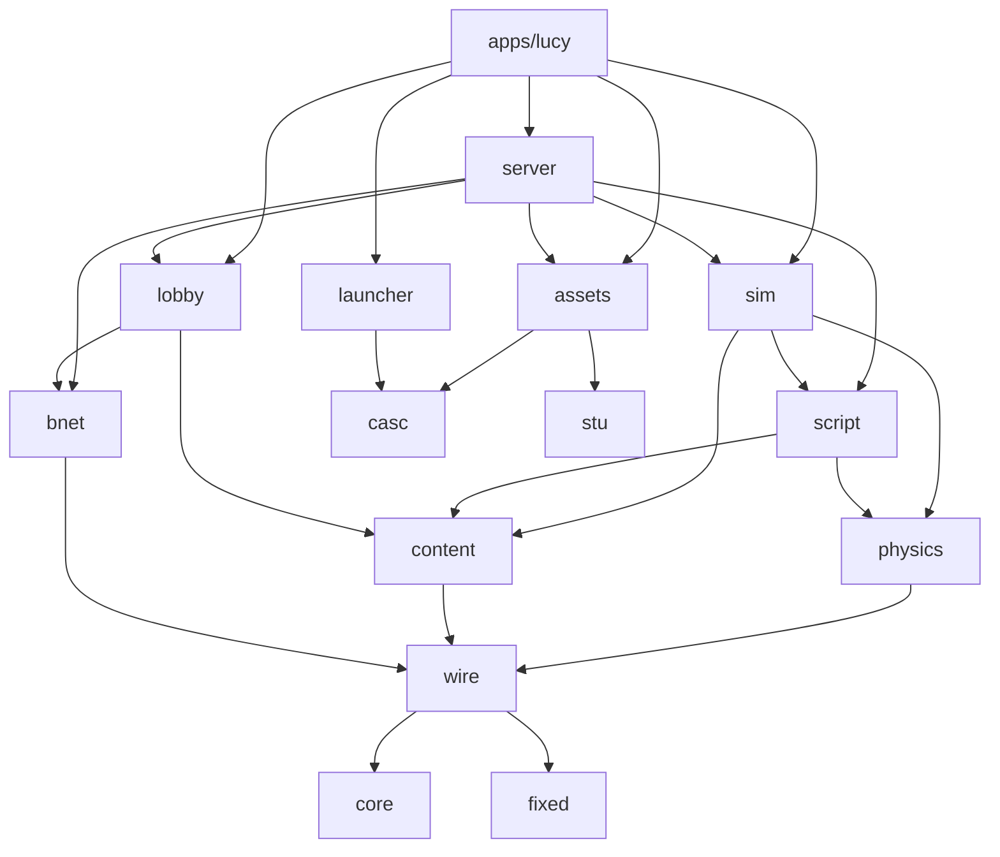
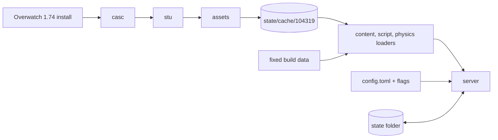

# Architecture

Lucy is one Cargo workspace. It builds one program, `lucy.exe`, and one DLL, `owwfd_relay.dll`. The server supports only the client build 1.74.0.0.104319.

## Layout

```
Lucy/
├─ Cargo.toml          workspace only
├─ crates/             the libraries (below)
├─ apps/lucy/       the lucy program: command line, doctor, modes
├─ web/dashboard/      the dashboard (Vite, Svelte, TypeScript): src/, and its build in dist/, which is committed and embedded into the binary
├─ research/ida/       the IDA script that extracted the statescript codecs
├─ tools/              the client tools (Python): index, game database, debugger (docs/dev/client-tools.md)
├─ docs/user/          for players and hosts
├─ docs/dev/           for developers
├─ docs/notes/         research notes: protocol, behavior, references
├─ justfile            the developer recipes
└─ START.cmd           builds, then runs lucy
```

## Crates

Each package is named `lucy-<folder>`.

| Crate | Responsibility |
| --- | --- |
| `core` | GUID text, bit readers and writers, the game tick constants |
| `fixed` | The fixed build data (`crates/fixed/data`), embedded with `include_bytes!` |
| `wire` | Byte-exact encodings: the JAM lobby protocol, the game link, entity records, input commands, TCP helpers |
| `content` | Typed game content and its loaders: catalog, heroes, maps, stats, hero-select parameters |
| `bnet` | Local Battle.net emulation: protocol, RPC, session keys, service |
| `physics` | Collision, the contact solver, the character mover, static rays, AI navigation |
| `script` | Statescript: graphs, expressions, the VM, payload codecs, snapshots and their wire format, vitals |
| `sim` | The match simulation: bodies, bots, combat, projectiles, replication, egress |
| `lobby` | Lobby services: accounts, collection, login content, parties, matchmaking rules, match handoff |
| `server` | Process wiring: the lobby threads, the game service, connections, ingress, the dashboard API |
| `casc` | Reads assets out of the install's CASC storage, with the build 104319 manifest |
| `stu` | Reads STUv2 structured assets with the 1.74 type table generated from OWLib |
| `assets` | Derives the server's data files from the install and keeps them in the cache |
| `launcher` | Windows: finds, checks, starts and injects the client |
| `relay` | Windows `cdylib`, `owwfd_relay.dll`: pipes the client's Battle.net stream to the local server |
| `testkit` | Test support: finds the game for ignored tests, builds synthetic storages |
| `apps/lucy` | The `lucy` program |

### Dependency rules

An arrow means "depends on". Only these edges exist (normal dependencies, from the `Cargo.toml` files):



Most crates also use `core` and `fixed` directly; the graph leaves out those edges.

- `lobby` and `sim` never depend on each other. `server` connects them.
- `casc`, `stu`, `core`, `fixed` and `relay` depend on nothing in the workspace.
- `assets` produces files, not types. It does not depend on `content`, `script` or `physics`; the server's loaders read the files it writes.
- `testkit` is only a dev-dependency.
- Only `launcher`, `relay` and `probe` (the client probe DLL, `docs/dev/client-tools.md`) use `unsafe`. Every other crate, the app included, has `#![forbid(unsafe_code)]`. In those three, every `unsafe` block states why it is sound, and `unsafe_op_in_unsafe_fn` is denied.
- Library crates return typed errors or `io::Error`. `apps/lucy` reports them and sets the exit code.

When you add a dependency between crates, keep it in the direction of the graph. Cargo refuses cycles.

## Data flow



1. **Install.** The user names the game with `--game`, `LUCY_GAME` or `game` in `config.toml`. The launcher reads `.build.info` and refuses any build other than 104319.
2. **casc.** Reads the build config, the local indices and `data.NNN` archives, the encoding table and the 104319 manifest. It decodes BLTE blocks, including Salsa20-encrypted blocks. One key the install's keyring lacks comes from TACTLib's static keyring.
3. **stu.** Decodes STUv2 assets (graphs, entity definitions, game modes and more) with the type table in `crates/stu/data/types.txt`.
4. **assets.** Runs the derivations in dependency order (`DERIVATIONS`). Each writes one file in the format of the old prepared runtime pack. Collision for a map other than the Practice Range is built when a match on that map first starts.
5. **Cache.** The files go to `<state>/cache/104319/`. A stamp (`derived.txt`) holds the build version, build config key, locale and derivations version. Another stamp makes the next start derive again. A full derivation takes about two minutes in a release build.
6. **Loaders.** `content`, `script`, `physics` and `sim::scene_assets` load the cache files. `server::game_data` lists the files the server needs.
7. **Fixed data.** Some inputs are not in the install: message schemas, statescript payload codecs, Battle.net descriptors, the lobby state-blob key, the captured server templates, resource keys and the research names. They are embedded from `crates/fixed/data`.

[data-sources.md](data-sources.md) lists each file, its inputs and the oracle it was checked against.

## The server

`lucy_server::server::Server::start` starts these services. Each has its own threads; there is no async runtime.

| Service | Transport | Default port |
| --- | --- | --- |
| Battle.net, the address the client dials | TCP | 1119 (`stall`) |
| Battle.net RPC, where the relay pipes the stream | TCP | 21119 (`rpc`) |
| Lobby (JAM protocol) | TCP | 3724 |
| Game server | UDP | 3730 |
| Dashboard (HTTP/1.1, `server/dashboard/http.rs`) | TCP | 3725 |

### TCP connections

The lobby, Battle.net and the dashboard serve their TCP connections the same way (`wire::tcp`):

- **Accept loop.** One thread per listener (`lucy-lobby`, `bnet`, `lucy-dashboard`) polls its non-blocking listener every 10 ms and stops when `Server::stop` asks.
- **One thread per connection** (`PeerWorkers`), within the listener's limits: so many connections in all and so many from one address (`PeerLimits`; the numbers are in [behavior.md](../notes/behavior.md), "Lobby, Battle.net and dashboard connections"). A connection over a limit is closed at once, and the first refusal is logged. The accept loop joins the thread of each connection that ended before its next accept, so no thread outlives its connection by more than a poll.
- **Deadlines.** Each stream (`PeerStream`) reads its deadlines from the service's clock: the lobby's clock for the lobby and the dashboard (virtual in tests), the wall clock for Battle.net. A connection's first deadline (its handshake's) starts at its accept; the service sets the next ones (login, idle, keep-alive). Reads and writes poll every 250 ms, so a deadline or a stop is seen within one poll.
- **Shutdown.** Stopping a service closes its listener, sets the workers' stop flag (a blocked read sees it within a poll) and joins every connection's thread. `Server::stop` stops the dashboard, Battle.net, the lobby, then the game service.

### Lobby

The lobby lives in `crates/server/src/lobby` and uses the services of the `lobby` crate.

- **Sessions.** Each client connection has its own thread. It runs the handshake and login, then a loop that reads messages and answers them. The loop wakes at least every lobby tick (250 ms on the lobby's clock) and then checks the session's mailbox and how long the game has been quiet.
- **Router.** `router.rs` decides which handler answers each client message after login.
- **Modules.** Each feature (chat, friends, party, matchmaking, shop, rewards, settings and more) is a module under `handlers/`. A module declares the messages it answers and its session hooks. `handlers::MODULES` lists all modules. To add a feature, add a module and list it there.
- **Hub.** `hub.rs` keeps the sessions that are online. A session that must tell another session something (a whisper, an invite, a friend's status) posts it to that session's mailbox. The other session sends it at its next wake. A mailbox holds at most 256 messages; one that overflows shuts, refuses further mail as for an offline account, and its session ends so the game logs in again with the whole state.
- **Matchmaker.** Forms matches from the queues and hands the players to the game service.

### Game service and simulation

`server::game_service::GameService` is the UDP match server. Other threads (the lobby's sessions and matchmaker, the dashboard, a scene's preparation) talk to it through a request channel.

- **Threads.** A router thread (`lucy-game`, `game_service/router.rs`) owns the UDP socket (one port, 3730) and the request channel. It routes each datagram by the connection id in its header to the channel of the room that has that connection. A datagram that can't be a game's, whose connection no room has (its match ended, or never had it), or whose game already has 64 waiting is dropped there. The router answers the requests about no single room (opening a match, the results of the matches that ended, the live nameplate and hurt feedback tools' settings) and passes the others to the room of their match or seat; for the snapshot and the nameplate tool each room answers its own part to the caller. Each match is a room on a thread of its own (`lucy-room-XXXX`, `game_service/room.rs`) with its own loop and clock; it sends through a clone of the socket. Rooms share only what never changes (`Arc`: the schemas, the scene assets their scenes come from, the nameplate tool's plate). A room tells the router through events when one of its links closes, when its match ends by its rules, and when its thread ends.
- **Clock.** Every room ticks on the service's grid (`clock.rs` `GameClock::opened`): a tick every 16 ms from the service's start, with the same frame number in every room. A room that falls behind skips the ticks it missed.
- **Timing.** Each room counts what its ticks cost (`game_service/timing.rs`): a tick's work is everything its thread did for the match since the tick before, split by phase (`core::phase`: receive, simulate, ai, script, workshop, replicate, crypto, send; each counts its own time, not the phases it calls), and on the real clock how late the tick began and the frames the clock skipped. Every 10 s of its clock a room logs the window (target `lucy::timing`) and keeps it with the totals since it opened in `MatchSnapshot::timing`, which the dashboard reads through the router's snapshot. The load harness reads the same numbers ([testing](testing.md#load-harness)).
- **Faults.** A room catches a panic of its loop (release and `gametest` builds; a Cranelift debug build aborts the process): its match stops, its games go back to the menu (20304) as at the end of the clock's frames, and its seats go as they close their links or time out, which the lobby sees as their leaving (`seat_exists`). If it fails again meanwhile, its thread ends; the router drops its connections, so its seats are gone and its games' datagrams are dropped.
- **Tests.** The lockstep (`game_service/lockstep.rs`) runs the same router and rooms on one thread on a virtual clock ([testing](testing.md#game-service-tests)); only `GameService::bind` starts threads.
- **Rooms.** Each match is a room with its map, its players and its world. The room's scene, with the map's collision, is prepared on another thread while the players load. Players can join a running match.
- **Connections.** The lobby sends each player the server address, a connection id and two keys (message 20600). `server::connection` admits the player and keeps the encrypted link; the room of the match keeps its players' links. `server::ingress` orders incoming messages and tracks the loading steps.
- **Simulation.** The `sim` crate holds bodies, bots, combat, hitscan, projectiles and pools. It runs at the game tick in `core::tick`.
- **AI heroes.** In Practice vs AI (and with `--test-ai`) the room fills its teams with AI players: a seat without a game, a real hero body in a headless `WorldDelivery` whose records arrive at once, and `sim::ai::AiController`, which makes each tick's command from what the AI sees (navigation from `physics::nav`, line of sight through the collision). Other clients see them as any other player.
- **Replication.** `sim::replication` builds what each peer sees: entity creates, updates and the owning player's body. `sim::egress` packs it into datagrams within the size limits in [protocol.md](../notes/protocol.md).
- **Statescript VM.** `script::vm` runs the authored statescript graphs of heroes, modes and bots: entry, variable writes, links, sub-scripts, waits, messages, abilities and timers. `script::snapshot` and `script::stream` encode the VM state for the client with the payload codecs from the fixed data.

### Unknowns policy

The VM does not implement every node of every graph. `script::vm::Unknowns` decides what happens with graph content it does not know:

- **Refuse** (debug builds and tests): record a diagnostic and refuse the body. A gap cannot hide.
- **Tolerate** (release builds): do what the Python reference did, and record each case in the snapshot's assumptions. An unknown state is a plain state. An unknown action follows its out plug. An unknown config value or opcode is null. An active state whose payload cannot be written is left out of frames and logged once per class (`script::snapshot`).

Every verified class of the client's codec table must have a payload family in `script::codecs`: `CodecTable::client()` panics in a debug build when one has none.

So a debug build can stop a hero that a release build plays. Use a release build to play and a debug build to find gaps.

### Dashboard

The dashboard backend is in `server` and serves the dashboard's build. It shows the server state and the saved profiles and can change them. It can also start a second game for another account. Its HTTP/1.1 server (`dashboard/http.rs`) is the shared TCP model above; it handles the requests one at a time, whichever connection they come on.

The front end is in `web/dashboard`: a Svelte 5 and TypeScript single-page app that Vite builds into `web/dashboard/dist/` (`just dashboard-build`). The build is committed, so `cargo build` needs no Node. While you work on it, `npm run dev` there serves the page with hot reload and sends `/api` to a running `lucy serve` (port 3725, or the address in `LUCY_DASHBOARD`). `server/build.rs` lists the files of `dist/` and embeds them with `include_bytes!`, with their MIME types. The server answers a GET this way:

- `/api/...`: the JSON API (`dashboard/api*.rs`).
- A file of the build: the scripts and styles under `/assets/` have a content hash in their names and are cached for a year (`immutable`). `index.html` and `favicon.svg` are sent with `no-cache`.
- `/assets/boxes/*.png` and `/assets/previews/*.webp`: optional pictures from the assets folder.
- Any other path without a file extension: `index.html`. The page routes itself (`/events`, `/matches/<id>` and so on, `src/lib/routes.ts`).

In the front end, `src/lib/api.ts` is the typed client of the API and `src/lib/types.ts` holds the reply types. `src/lib/live.ts` is the client of the live-match API that stage 3 adds ([server-architecture-plan.md](server-architecture-plan.md)); `src/lib/sse.ts` reads the server-sent events planned for `/api/events`. The pages that need them show "Not available yet" while the server answers their routes with 404. The page reads `/api/state` every 10 s while it is visible.

With `LUCY_DEBUG_SEND=1` it also has the debug routes (`server/dashboard/debug.rs`, [troubleshooting](../user/troubleshooting.md#marker-messages)). The marker message routes encode a message with the schema encoder and send it on the normal paths: a game link message goes to the game service as a request (`GameService::debug_send`), which queues it on the seat's reliable channel like the server's own messages; a lobby message is posted to the account's session through the hub. `POST /api/debug/kill` asks the game service to kill an account's hero through the normal death path (`Combat::environment_kill`); the client tools' `die` action uses it.

## The program

`apps/lucy` reads the command line with `clap`, resolves the settings, starts logging and runs a mode. Settings come from, in this order: the command-line flag, the `LUCY_*` environment variable, `config.toml`, the default. See the [commands reference](../user/commands.md) and [configuration](../user/configuration.md).

`play` and `host` start the server, then the launcher starts the game with `--BNetServer` and `--tank_Locale`, and injects the relay. The relay must be the `owwfd_relay.dll` next to `lucy.exe`, so the DLL always comes from the same build. The launcher tells the relay its log file and the RPC port through environment variables.

## State folder

The state folder is `%APPDATA%\lucy` on Windows (from the `directories` crate). `--state` or `LUCY_STATE_DIR` chooses another folder. Nothing is written into the checkout.

| Path | Content |
| --- | --- |
| `config.toml` | Settings |
| `profiles/` | One JSON file per saved account |
| `profile.json` | The template for new accounts |
| `default_account.txt` | The account the local game logs in as |
| `game_path.txt` | The game picked in the file dialog |
| `public_address.txt`, `server_address.txt`, `player_name.txt` | Answers the modes remember |
| `logs/lucy.log` | Server log, 2 MB, with two older files |
| `logs/game.log`, `logs/relay.log` | Game output and the relay log |
| `cache/104319/` | Data derived from the install |

## Network

The program opens only its own listeners, the connections a join needs, and the relay pipe. It never downloads anything.
